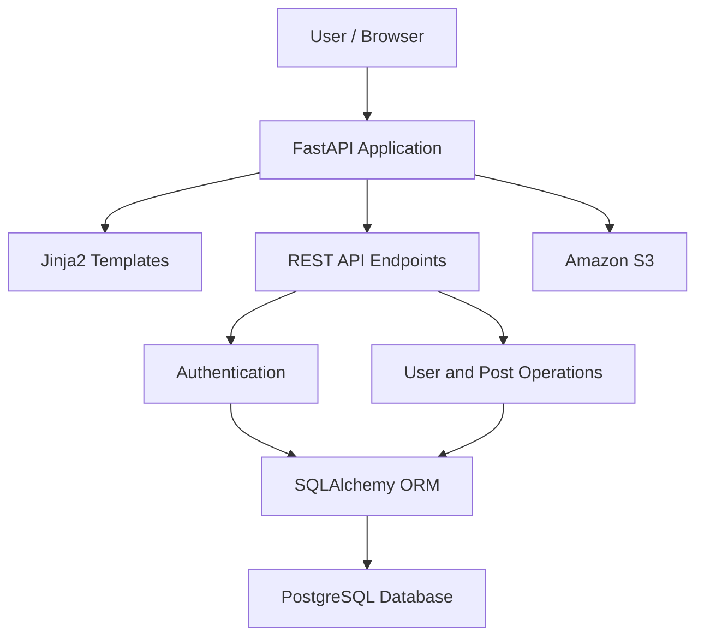

# FastAPI Blog Platform

A full-stack blog application built with **FastAPI and Python**, featuring user authentication, blog post management, profile management, and RESTful APIs. The application is deployed on Render and provides interactive API documentation through Swagger UI.

## 🌐 Project Links

- **Live Website:** [FastAPI Blog](https://fastapi-project-dyn0.onrender.com)
- **API Documentation:** [Swagger UI](https://fastapi-project-dyn0.onrender.com/docs)
- **GitHub Repository:** [FastAPI_PROJECT](https://github.com/ankitabehera888/FastAPI_PROJECT)

## 📌 Project Overview

FastAPI Blog is a web-based blogging platform designed to demonstrate modern backend development using FastAPI. It combines a server-rendered frontend with API endpoints for user and blog management.

The project includes authentication, database integration, password management, profile-image storage, and cloud deployment.

## ✨ Features

- **User Authentication:** User registration, login, and access-token generation.
- **Blog Management:** Browse blog posts and manage post-related operations.
- **Profile Management:** Retrieve and update user information.
- **Password Management:** Password recovery, reset, and change functionality.
- **Image Storage:** Integration with Amazon S3 for profile-image storage.
- **RESTful APIs:** Structured endpoints for users and blog posts.
- **Interactive API Documentation:** Explore and test endpoints using Swagger UI.
- **Database Migrations:** Manage database schema using Alembic.
- **Cloud Deployment:** Hosted on Render.

## 🏗️ System Architecture



## 🛠️ Tech Stack

| Category | Technologies |
|---|---|
| Backend | Python, FastAPI |
| Frontend | HTML, CSS, JavaScript, Jinja2 |
| Database | PostgreSQL, SQLAlchemy |
| Authentication | Token-based authentication |
| Database Migrations | Alembic |
| ASGI Server | Uvicorn |
| Dependency Management | uv |
| Image Storage | Amazon S3 |
| API Documentation | Swagger UI, OpenAPI |
| Deployment | Render |
| Version Control | Git, GitHub |

## 📂 Project Structure

```text
FastAPI_PROJECT/
├── alembic/
├── routers/
│   ├── users.py
│   └── posts.py
├── static/
├── templates/
├── tests/
├── alembic.ini
├── auth.py
├── config.py
├── database.py
├── emails_utils.py
├── image_utils.py
├── main.py
├── models.py
├── schemas.py
├── pyproject.toml
├── uv.lock
└── README.md
```

## 🚀 Getting Started

### Prerequisites

- Python 3
- Git
- PostgreSQL or a compatible configured database
- uv package manager

### 1. Clone the Repository

```bash
git clone https://github.com/ankitabehera888/FastAPI_PROJECT.git
cd FastAPI_PROJECT
```

### 2. Install Dependencies

```bash
pip install uv
uv sync --frozen
```

### 3. Configure Environment Variables

Create a `.env` file in the project root and configure the variables required by the application, including your database connection, secret key, and any required AWS S3 and email credentials.

**Important:** Never commit your `.env` file or private credentials to GitHub.

### 4. Run Database Migrations

```bash
uv run alembic upgrade head
```

### 5. Start the Application

```bash
uv run uvicorn main:app --reload
```

Open the application in your browser:

- **Website:** http://127.0.0.1:8000
- **API Documentation:** http://127.0.0.1:8000/docs

## ☁️ Deployment

The project is deployed using **Render**.

- **Live Application:** https://fastapi-project-dyn0.onrender.com
- **Swagger Documentation:** https://fastapi-project-dyn0.onrender.com/docs

The application runs using Uvicorn, while database connections and other sensitive configuration values are managed through environment variables.

## 🔮 Future Improvements

- Add blog search and category filtering.
- Introduce comments, likes, and bookmarking.
- Improve automated testing and continuous integration.
- Enhance monitoring, logging, and production security.

## 👩‍💻 Author

**Ankita Behera**

- **GitHub:** [ankitabehera888](https://github.com/ankitabehera888)
- **LinkedIn:** [Ankita Behera](https://www.linkedin.com/in/ankita-behera-327446400/)

---

*Built with Python and FastAPI.*
